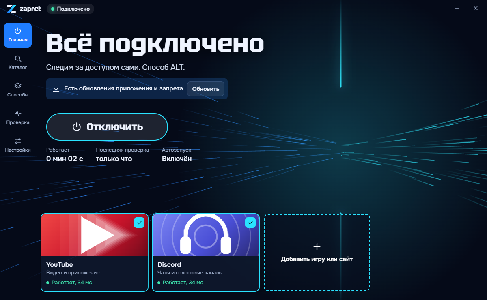
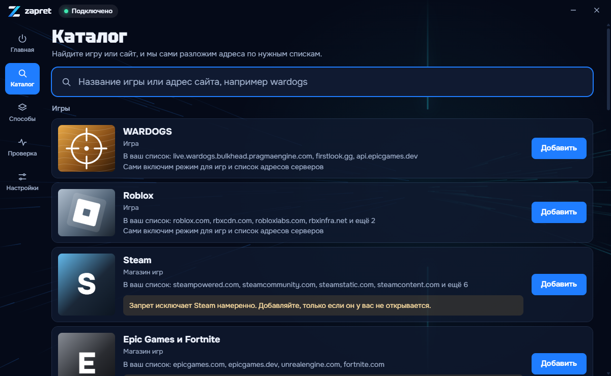

<p align="center">
  
</p>

<p align="center">
  <a href="https://github.com/Arkadiy2009/zapret-app/releases/latest"></a>
  <a href="https://github.com/Arkadiy2009/zapret-app/releases"></a>
  
  <a href="LICENSE"></a>
</p>

<p align="center">
  <b>Простое приложение для Windows поверх <a href="https://github.com/Flowseal/zapret-discord-youtube">zapret-discord-youtube</a>.</b><br>
  Вместо папки со странными файлами одна кнопка: приложение само находит способ, который работает у вашего провайдера.
</p>

<p align="center">
  <a href="https://github.com/Arkadiy2009/zapret-app/releases/latest"><b>Скачать последнюю версию</b></a>
</p>

<br>



## Что умеет

- **Подключение одной кнопкой.** Подбирать вручную 22 файла `general*.bat` больше не нужно.
- **Умный подбор.** Первыми проверяются способы, которые уже работали у вас, остальные проходят быстрый отсев. Подходящим способ считается только после полной проверки по адресам из `test zapret.ps1`.
- **Каталог игр и сервисов.** WARDOGS, Roblox, Steam, Twitch, X, ChatGPT, GitHub и другие: приложение само разложит адреса по нужным спискам и включит режим для игр, если он нужен.
- **Автозапуск и слежение.** Обход работает как служба Windows. Если способ перестал открывать ваши сервисы, приложение подберёт новый.
- **Обновления внутри приложения.** Запрет обновляется из релизов Flowseal, само приложение из этого репозитория. Контрольные суммы сверяются, а если новая версия запрета не заработает, приложение вернёт прошлую.
- **Проверка компьютера.** Находит мешающие программы, подмену DNS и другие частые причины сбоев.

<table>
  <tr>
    <td></td>
    <td></td>
  </tr>
  <tr>
    <td align="center">Подбор способа</td>
    <td align="center">Каталог игр и сервисов</td>
  </tr>
</table>

## Как установить

1. Скачайте `zapret-setup-*.exe` со [страницы релизов](https://github.com/Arkadiy2009/zapret-app/releases/latest).
2. Запустите файл. Если появится SmartScreen, нажмите «Подробнее», затем «Выполнить в любом случае». Файл пока без цифровой подписи.
3. Отметьте, что должно работать, и дождитесь конца подбора.

Если у вас уже стоит запрет как служба, приложение заберёт ваш способ, строки из списков и настройки игр. Старую папку оно не меняет.

> [!IMPORTANT]
> Скачивайте приложение только со страницы релизов этого репозитория. Копии на других сайтах могут быть подделкой.

## Частые вопросы

<details>
<summary><b>Антивирус ругается. Это вирус?</b></summary>
<br>
Обход использует драйвер WinDivert, который перехватывает сетевой трафик. Поэтому антивирусы часто помечают его как RiskTool. Установщик собирается из этого открытого кода на GitHub Actions, а сумму файла можно сверить на странице релиза.
</details>

<details>
<summary><b>Зачем права администратора?</b></summary>
<br>
Они нужны, чтобы поставить службу и драйвер. Трафик никуда не уходит: всё работает на вашем компьютере, это не VPN.
</details>

<details>
<summary><b>Какие данные приложение отправляет?</b></summary>
<br>
Никаких данных о вас. Приложение обращается к GitHub за обновлениями и открывает проверочные адреса, чтобы понять, работает ли способ.
</details>

<details>
<summary><b>Способ перестал работать</b></summary>
<br>
Отключитесь и нажмите «Подобрать заново». Выключите VPN на время подбора. Если не помогло, откройте раздел «Проверка». Журнал лежит в <code>C:\ProgramData\zapret\zapret-app.log</code>, приложите его к <a href="https://github.com/Arkadiy2009/zapret-app/issues">обращению</a>.
</details>

## Для разработчиков

```powershell
npm install
npm run core   # скачать запрет из релиза Flowseal и сверить сумму
npm test       # логика на заглушке, запрет не запускается
npm run dev    # окно на заглушке системы
npm run dist   # dist/zapret-setup-<версия>.exe
```

Новая версия приложения выходит так: поднимите `version` в `package.json` и отправьте тег `v1.2.3`. GitHub Actions соберёт установщик и создаст релиз, а установленные приложения сами предложат обновиться.

| Файл | За что отвечает |
| --- | --- |
| `src/main/scan.js` | Подбор способа |
| `src/main/strategy.js` | Чтение способов прямо из `general*.bat` |
| `src/main/engine.js` | Служба, `winws`, `curl`, диагностика |
| `src/main/config.js` | Списки, режим игр, адреса |
| `src/main/update.js` | Обновления запрета и приложения |
| `src/main/controller.js` | Логика приложения |
| `src/shared/catalog.js` | Каталог игр и сервисов |

Добавить игру или сервис в каталог можно одной записью в `catalog.js`: пулреквесты приветствуются.

## Благодарности

Вся работа по обходу сделана не здесь. Это неофициальная оболочка, она не связана с авторами оригинальных проектов.

- [Flowseal/zapret-discord-youtube](https://github.com/Flowseal/zapret-discord-youtube): сборка, способы и списки
- [bol-van/zapret](https://github.com/bol-van/zapret): `winws`, основа всего
- [basil00/WinDivert](https://github.com/basil00/WinDivert): драйвер перехвата пакетов

Лицензии сторонних компонентов перечислены в [THIRD-PARTY.txt](resources/THIRD-PARTY.txt). Приложение распространяется по лицензии [MIT](LICENSE). Пользуйтесь им в рамках законов своей страны.

---

<p align="center">
  <sub>Приложение бесплатное и останется бесплатным. Но если оно вам пригодилось и хочется, чтобы разработчику было на что покушать,<br>
  <a href="https://www.donationalerts.com/r/dOne">можно угостить его здесь</a>. Ему будет очень приятно ❤️</sub>
</p>
